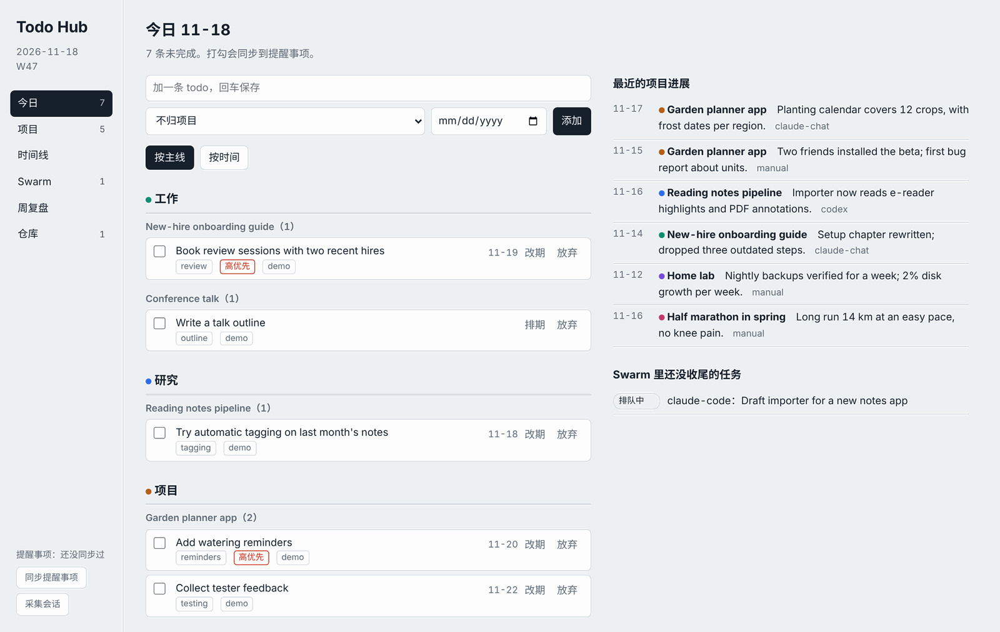
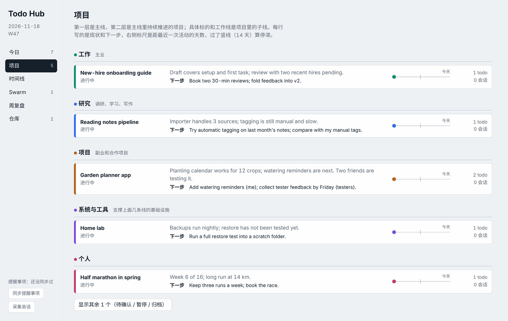
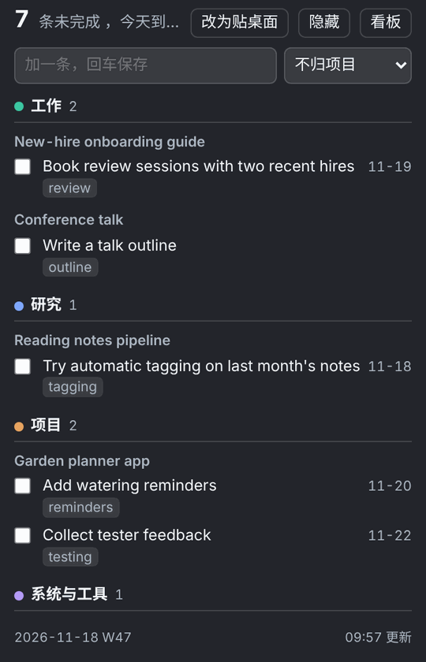

# Todo Hub

English · [中文](README.zh-CN.md)

A local-first personal project and todo dashboard for macOS, with an agent swarm orchestrated by Claude and a native menu-bar widget.

- **Pure Python standard library.** No third-party dependencies, no cloud service, no account.
- **Your data stays on your Mac.** Everything is plain files under `data/`; nothing in the repo knows who you are.
- **The UI is in Chinese for now.** The code, CLI and data model are language-neutral; translations are welcome (see [CONTRIBUTING.md](CONTRIBUTING.md)).



<details>
<summary>More screenshots</summary>

**Projects** — each project shows its current state, next step and how long since the last activity.



**Desktop panel** — the same list in a floating panel (also in the menu bar).



</details>

All screenshots use the fictional demo data from `scripts/demo.py`.

## Try it without installing

```bash
git clone <this repo's URL> todohub && cd todohub
python3 scripts/demo.py          # made-up data in a temp folder → http://127.0.0.1:8799
```

Nothing is written outside the temp folder, nothing is synced to Reminders and no agent runs.

## How it works

```
            Claude (orchestrator: nightly update, weekly review, ad-hoc chats)
                 │  reads conversations + a daily digest → writes progress / todos / tasks
                 ▼
   ┌──────────────────────────── hub CLI (the only write path) ────────────────────────────┐
   │  data/events/  one file per change, append-only; current state = replay of all events  │
   └────────────────────────────────────────────────────────────────────────────────────────┘
        ▲            ▲                    ▲                     ▲                 ▲
   Dashboard     Local daemon        Codex / Claude Code    Mailbox bots      macOS Reminders
  127.0.0.1    collect · sync · run   (launched by daemon)  (poll for tasks)  (two-way mirror)
```

- **Event store.** Every change (new todo, progress note, task result) is a new JSON file that is never edited. State is rebuilt by replaying them, so several agents can write at once without overwriting each other.
- **Areas → projects → threads.** Top-level areas are yours to define (`config/taxonomy.local.json`). Each project keeps three lines, `goal`, `state` and `next`, which the orchestrator rewrites as things change.
- **Swarm.** Claude decides what to dispatch; the daemon runs CLI agents (Codex, Claude Code, a local model via Ollama) under a daily cap and a timeout. Bots that can run local commands pull work with `hub task next`. Rules for what may and may not be dispatched live in [CLAUDE.md](CLAUDE.md).
- **Collectors.** The daemon reads local Codex and Claude Code session logs and matches them to projects by working directory.
- **Reminders sync.** A dedicated Reminders list mirrors open todos; items you check off or add on your phone come back.
- **Repo screener.** Keeps a registry of AI-related open-source projects installed on the machine (git clones, zip downloads, npm/pipx/uv/brew packages, Ollama models, agent config folders, apps).
- **Weekly review.** A numbers layer generated any time, plus a short written review by Claude on Sundays.

## Requirements

- macOS 12 or later (the dashboard and CLI also run on Linux; Reminders sync and the widget are macOS-only)
- Python 3.9+
- Xcode Command Line Tools (`xcode-select --install`), for the widget's clang build
- Optional: [Codex CLI](https://github.com/openai/codex), [Claude Code](https://docs.claude.com/en/docs/claude-code), `zstd` (older Codex logs are compressed)

## Install

```bash
git clone <this repo's URL> ~/code/todohub     # anywhere you like
bash ~/code/todohub/install.sh
```

The installer registers a login item (`launchd`, no sudo), links `hub` into `~/.local/bin`, runs a first collection and Reminders sync (macOS asks once for permission), opens the dashboard at http://127.0.0.1:8791 and builds the widget. Uninstall with `bash uninstall.sh`; your data is left in place.

## Personal configuration

Everything committed is a generic example. Your own settings go in `.local` files, which are git-ignored:

| Example (committed) | Yours (ignored) | Effect |
|---|---|---|
| `config/hub.json` | `config/hub.local.json` | Key-by-key override: timezone, your name (`owner_name`), GitHub owners, Reminders lists, scan roots… |
| `config/agents.json` | `config/agents.local.json` | Replaces or adds agents by name |
| `config/taxonomy.json` | `config/taxonomy.local.json` | Replaces the example areas entirely |
| `CLAUDE.md` | `CLAUDE.local.md` | Personal notes the orchestrator reads after `CLAUDE.md` |

Each has a `.example` template next to it: copy it, drop `.example`, edit. Restart the daemon after changing config: `hub restart`.

In `config/agents.json`, `{root}` expands to the repo directory, and `{prompt}`, `{cwd}`, `{out}`, `{model}` to the task's values. Codex runs with `--sandbox workspace-write` by default.

## Daily use

```bash
hub status
hub todo add "Read this week's papers" -p my-research --due 2026-11-30
hub todo done T-XXXXX
hub progress my-research "Minimal version works" --source manual
hub repos plan https://github.com/owner/repo --note "want to try"
hub repos scan --online          # also fetch stars / archived status from GitHub
hub review --print               # this week's numbers
hub pause / hub resume           # stop / restart dispatching
```

`hub <command> -h` lists all options.

## Menu bar and desktop panel

`widget/` is a small native app (about 300 lines of Objective-C) that only talks to the local daemon. The menu-bar item shows the open count (and overdue/today counts); click for the full list, check items off or add one. The same list can float above all windows, sit on the desktop under them, or hide. Rebuild with `bash widget/build.sh`. The UI itself is `todohub/web/widget.html`, so most changes need no rebuild.

## Scheduling the orchestrator

Claude's nightly update and weekly review run as scheduled tasks with access to this folder. See [docs/scheduling.md](docs/scheduling.md) for the prompts.

## Security model

The dashboard binds to 127.0.0.1 only, and write requests must carry a custom header and a matching `Host`, so web pages you visit cannot inject tasks. Dispatch can be fully automatic, so the guardrails matter: see [SECURITY.md](SECURITY.md).

## Publishing your fork without leaking personal data

`bash scripts/publish.sh` commits and pushes, but only after `scripts/audit_public.py` passes. The audit blocks:

- personal data folders (`data/`, `inbox/`, `reviews/`, `logs/`, `swarm/`) and any `.local` file;
- anything that looks like a token or private key, URLs with credentials, `/Users/<name>/` paths and email addresses;
- any word listed in `config/private-words.local.txt` (your name, employer, project names…; the list itself is never committed);
- a commit email that is not your GitHub `noreply` address (the script sets it for you).

Add `--history` to also scan every commit message, author email and every line ever added (including files deleted since). CI runs that on every push. Run it on its own with `python3 scripts/audit_public.py --history`.

## Documentation

- [docs/architecture.md](docs/architecture.md) — data layout, event types, daemon jobs, HTTP API, agent kinds
- [docs/scheduling.md](docs/scheduling.md) — setting up the orchestrator's nightly and weekly runs
- [CLAUDE.md](CLAUDE.md) — the orchestrator's playbook (Chinese) · [AGENTS.md](AGENTS.md) — notes for dispatched agents

## Tests

```bash
python3 tests/test_smoke.py     # end-to-end, in a temp folder
python3 tests/test_audit.py     # privacy audit
```

## Contributing

See [CONTRIBUTING.md](CONTRIBUTING.md). Report security issues as described in [SECURITY.md](SECURITY.md).

## License

[MIT](LICENSE)
