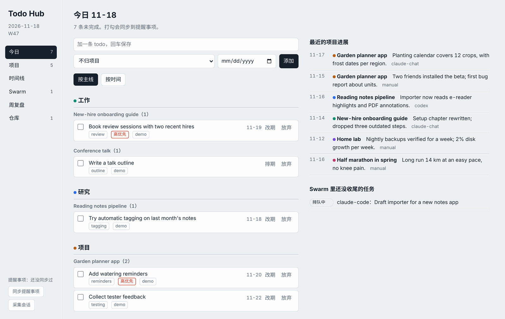

# Todo Hub

[English](README.md) · 中文

本机运行的个人项目 / Todo 看板，加一个由 Claude 编排的 agent swarm。纯 Python 标准库，无第三方依赖。



截图用的是 `scripts/demo.py` 生成的虚构数据。不安装也能先试：`python3 scripts/demo.py`（数据放在临时目录，看板在 http://127.0.0.1:8799，不同步提醒事项、不跑任何 agent）。

## 结构

```
            Claude（编排者：每晚更新、周日复盘、你随时来对话）
                 │  读对话 + 读简报 → 写进展 / todo / 派单
                 ▼
   ┌──────────────────────────── hub 命令（唯一写入口）────────────────────────────┐
   │  data/events/  一条变更一个文件，只增不改；当前状态 = 全部事件重放            │
   └──────────────────────────────────────────────────────────────────────────────┘
        ▲            ▲                  ▲                   ▲                ▲
   看板网页     本机常驻进程        Codex / Claude Code    Grok Bot       提醒事项
  127.0.0.1    采集·同步·执行派单    （被常驻进程调起）   （自己来取件）  （手机/桌面镜像）
```

| 你要的功能 | 在哪 |
|---|---|
| 按项目、按时间看进展和 todo | 看板「今日」「项目」「时间线」 |
| 跟踪各 AI 的对话 | Claude 对话：每晚定时任务读；Codex / Claude Code：常驻进程读本机会话日志；Grok Bot：它每天用 `hub progress` 汇报（见 prompts/grokbot-setup.md） |
| 同步提醒事项 | 常驻进程每 10 分钟同步「Todo Hub」列表；手机上打勾、手写的新提醒都会回到 Hub |
| Swarm | 看板「Swarm」；规则见 CLAUDE.md「派单」 |
| 周复盘 | 看板「周复盘」；数字层随时可生成，判断层由 Claude 周日写 |
| 开源仓库 screener | 看板「仓库」；`hub repos scan` |

## 安装（在 Mac 终端里跑一次）

要求：macOS 12+、Python 3.9+、Xcode 命令行工具（菜单栏小程序要用 clang 编译）。

```bash
git clone <本仓库地址> ~/code/todohub   # 放哪都行
bash ~/code/todohub/install.sh
```

看板地址 http://127.0.0.1:8791 。卸载：`bash uninstall.sh`（不删数据）。

## 菜单栏和桌面悬浮窗

`widget/` 里是一个原生的 Mac 小程序（约 300 行 Objective-C，本机用 clang 编译，只连本机的常驻服务）：

- **菜单栏**：显示未完成数（有逾期或今天到期会一起显示）。左键点开完整列表，可以打勾、加一条；右键是菜单。
- **悬浮窗**：同一份列表。三种状态可切换：置顶（盖在所有窗口上）、贴在桌面（在所有窗口下面）、隐藏。按住顶部一条拖动，边缘可拉伸，位置会记住。
- 登录后由常驻服务自动拉起；从它的右键菜单选「退出」后不再自动启动，手动打开 `widget/build/TodoHubBar.app` 即恢复。
- 重新编译：`bash widget/build.sh`。需要 Xcode 命令行工具（`xcode-select --install`）。界面是 `todohub/web/widget.html`，改它不用重新编译。

## 日常

```bash
hub status
hub todo add "整理本周读过的论文" -p my-research --due 2026-11-30
hub todo done T-XXXXX
hub progress my-research "最小版跑通" --source 手动
hub repos plan https://github.com/owner/repo --note "想试试"
hub repos scan --online          # --online 顺便查 GitHub 星数、是否归档
hub review --print               # 看本周复盘的数字层
hub pause / hub resume           # 暂停 / 恢复 swarm 派单
```

## 配置

仓库里的配置都是示例。你自己的设置写在同名的 `.local` 文件里，它们被 `.gitignore` 排除，不会上传：

| 示例（进仓库） | 你自己的（不进仓库） | 怎么生效 |
|---|---|---|
| `config/hub.json` | `config/hub.local.json` | 逐项覆盖示例：时区、你的名字（`owner_name`）、GitHub 账号、提醒事项列表、扫描目录…… |
| `config/agents.json` | `config/agents.local.json` | 同名 agent 整条替换，也可以新增 |
| `config/taxonomy.json` | `config/taxonomy.local.json` | 存在就整份替代：你的「主线」分类 |
| `CLAUDE.md` | `CLAUDE.local.md` | 编排者先读前者再读后者；写你是谁、标签怎么对应等个人约定 |

- `config/hub.json`：时区、端口、提醒事项列表名、扫描哪些目录、派单模式（`auto` 入队即执行 / `review` 等你放行）、每日执行上限、超时。
- `config/agents.json`：每个 agent 怎么调起，`{root}` 会换成本项目所在目录。Codex 默认 `--sandbox workspace-write`（只能写工作目录、不能联网）。
  加端侧模型：把 `local` 的 `enabled` 改成 true，命令换成你的（Ollama、MLX、llama.cpp 都行）。
- 改完配置重启常驻进程：`hub restart`（或 `launchctl kickstart -k gui/$(id -u)/com.todohub.daemon`）

## 几个要知道的点

- 仓库扫描默认跳过「桌面」「文稿」「下载」，因为后台进程读这三个目录会触发系统授权弹窗。
  想扫就从 `config/hub.json` 的 `scan_exclude` 里删掉对应项，弹窗时点允许。
- 项目登记了本机目录，会话才会自动归过去。没归类的会话在「项目」页底部，选一下项目即可。
- 旧的 Codex 会话是 zstd 压缩的，需要 `brew install zstd`（或 Python 3.14+）。
- zip 解压的仓库（`xxx-main`）没有版本信息，screener 只能记到目录和修改时间。建议改用 git clone。
- 看板只监听本机，写接口校验来源，防止你打开的网页往本机塞任务。
- 日志：`logs/daemon.log`；每次派单的完整输入输出：`swarm/runs/<任务id>/`。

## 个人配置与隐私

每个 `.local` 文件都有一份 `.example` 模板，复制去掉 `.example` 再改即可。

## 发布到 GitHub（隐私检查）

`bash scripts/publish.sh`：提交并推送（提交说明写在 `COMMIT_MSG` 里，没有就用「更新」）。每次推送前先跑 `scripts/audit_public.py`，有一项不过就不推：

- 个人数据目录（`data/`、`inbox/`、`reviews/`、`logs/`、`swarm/`）和所有 `.local` 文件不能出现在仓库里；
- 不能有密钥或令牌的样子（GitHub / OpenAI / AWS 令牌、私钥、带密码的地址），也不能有 `/Users/<名字>/` 这类本机路径；
- 不能出现你在 `config/private-words.local.txt` 里列的词（名字、邮箱、项目名、公司名……一行一个，这个文件本身不上传）；
- 提交作者邮箱必须是 GitHub 的匿名邮箱（`<id>+<账号>@users.noreply.github.com`），脚本会自动设置，不会暴露你的真实邮箱。

加 `--history` 还会检查全部提交历史：提交说明、作者邮箱、历史上新增过的每一行（包括后来删掉的文件）；CI 每次推送都会跑。单独检查：`python3 scripts/audit_public.py --history`。提交说明末尾想固定加一行署名，写在 `config/commit-trailer.local.txt`。需要 GitHub 命令行工具 `gh` 并登录（`brew install gh && gh auth login`；不用 brew 可以用 `bash scripts/install-gh.sh`，它会核对官方文件指纹和苹果代码签名）。

## 文档

- [docs/architecture.md](docs/architecture.md)：数据目录、事件类型、常驻服务的定时作业、HTTP 接口、agent 类型（英文）
- [docs/scheduling.md](docs/scheduling.md)：怎么配置 Claude 的每晚更新和周复盘（英文）

## 测试

```bash
python3 tests/test_smoke.py     # 端到端冒烟测试（临时目录）
python3 tests/test_audit.py     # 隐私检查的测试
```

## 参与贡献

见 [CONTRIBUTING.md](CONTRIBUTING.md)。安全问题见 [SECURITY.md](SECURITY.md)。

## 许可

MIT，见 [LICENSE](LICENSE)。
